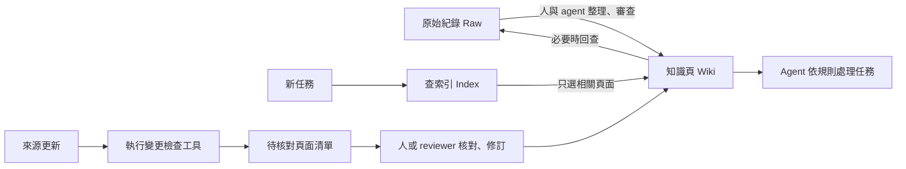
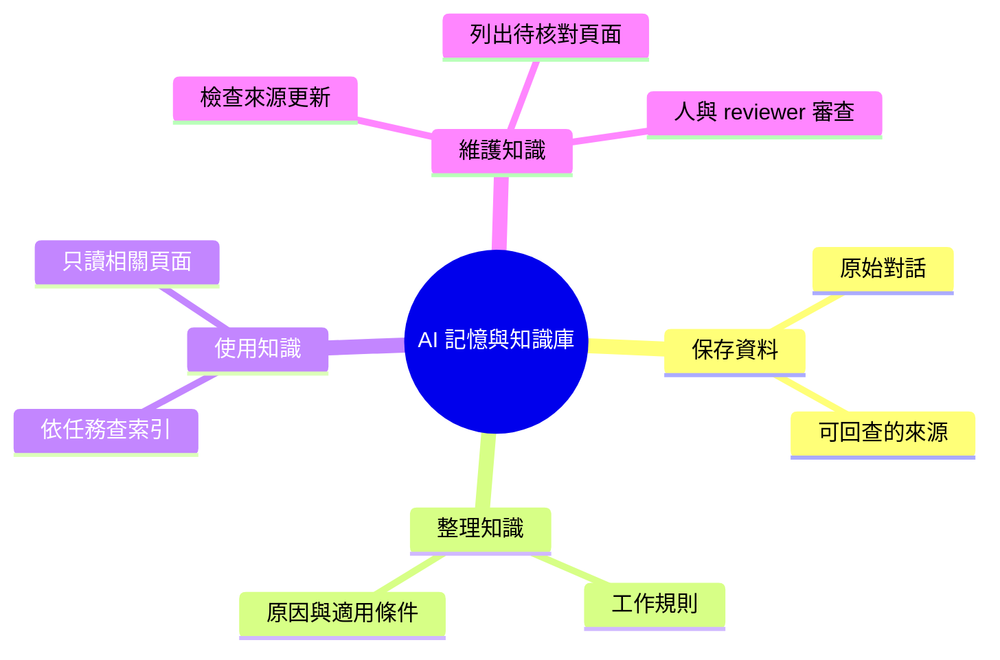

# AI 記憶與知識庫

把分散在對話中的工作規則整理成知識頁，讓 AI 助手接到任務後，先查索引、只讀相關內容，必要時回看原始紀錄。原始資料更新時，另有工具列出需要重新核對的頁面。

**適用對象：**需要讓 AI 助手持續使用工作規則的小型團隊或個人。
**目前交付：**可閱讀的 Wiki 範例、按需讀取流程設計，以及可執行的更新檢查工具；完整自動問答與知識維護服務尚未完成。

## 看一次使用過程

**問題：「可以用第三方工具處理這份文件嗎？」**

| 步驟 | Agent 讀什麼 | 用來做什麼 |
|---|---|---|
| 1. 找規則 | [知識庫索引](examples/agent-wiki/vault/INDEX.md) | 找到「工具選用」這個主題 |
| 2. 讀相關內容 | [工具選用規則](examples/agent-wiki/vault/wiki/tool-selection.md) | 確認先審查來源、權限與用途，並非禁止使用 |
| 3. 必要時查原話 | [原始討論](examples/agent-wiki/vault/raw/tool-policy-v1.md) | 核對整理後的規則是否保留原意 |

**預期回答：**「需要先確認工具來源、權限與用途；請提供工具資訊，再判斷能否使用。」

這是可點開閱讀的合成範例與預期行為，本合成案例尚未經模型實跑驗證。[完整案例與更新示範](examples/agent-wiki/README.md)

## 核心功能與完成狀態

| 功能 | 解決什麼問題 | 現況 |
|---|---|---|
| 保留原始紀錄（Raw） | 摘要寫錯時能回查，不讓整理稿取代原話 | 範例已提供 |
| 整理知識頁（Wiki） | 把規則、原因、適用條件放在一起 | 範例已提供；整理與審查由人和 agent 完成 |
| 按任務讀取（On-demand loading） | 先查索引，再讀相關頁面，避免每次讀全部歷史 | 讀取規約與研究執行器已有；完整行為待驗證 |
| 檢查更新影響 | 來源修訂後，找出需要核對的知識頁與索引 | Python 工具可執行，輸出 HTML／JSON |



上圖區分 agent 的使用流程與程式可執行的更新檢查；並非所有步驟都已自動串接。

## 快速開始：跑一次更新檢查

需要 Python 3.10+。下載 repo 後，在根目錄執行：

```sh
python3 -m venv .venv
.venv/bin/pip install -r requirements.txt
.venv/bin/python -B agent-wiki-demo.py --out runs/agent-wiki-demo
```

開啟 `runs/agent-wiki-demo/report.html` 查看報告。再次執行請換一個輸出目錄。

**這次發生什麼？** 原始規則新增「內部文件外傳需要授權」，範例將知識頁引用切到新版。程式會列出：

- `wiki/tool-selection.md`：來源已更新，需要核對規則內容。
- `INDEX.md`：依據該規則頁，需要核對索引說明。

新版來源需由維護者先連到知識頁；工具不會自動辨認新版取代哪份舊資料。

輸出狀態是 `needs_review`（需要核對）。程式只列出影響，不會自行判斷新規則、改寫頁面或批准內容。範例只修改輸出目錄中的複本，保留原始示例。

## 架構與技術棧



| 技術 | 中文用途 |
|---|---|
| Markdown / YAML | 保存可閱讀的知識頁、來源與索引 |
| Python / PyYAML | 讀取文件關係，執行變更檢查 |
| HTML / JSON | 分別交付給人檢閱與其他程式處理 |
| unittest | 驗證缺失來源、循環依賴及版本變更等情況 |

[知識庫架構](docs/wiki-workflow/architecture.md) · [更新檢查的演算法與設定](docs/change-impact-tool.md)

## 驗證與限制

更新示範可驗證「來源切換後，規則頁與索引被列入待核對」。它不驗證 AI 回答品質，也不會發現未宣告的來源關係。檔案未變動不代表內容正確。

```sh
.venv/bin/python -B -m unittest discover -s tests -v
```

[測試與比較評估](docs/evaluation.md) · [歷史案例及證據範圍](docs/wiki-workflow/case-study.md) · [尚待驗證的問題](docs/wiki-workflow/experiment.md)

Author: Nio (Master) · Implementation and editing: Codex · 2026-10-22
