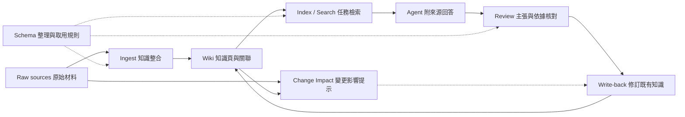
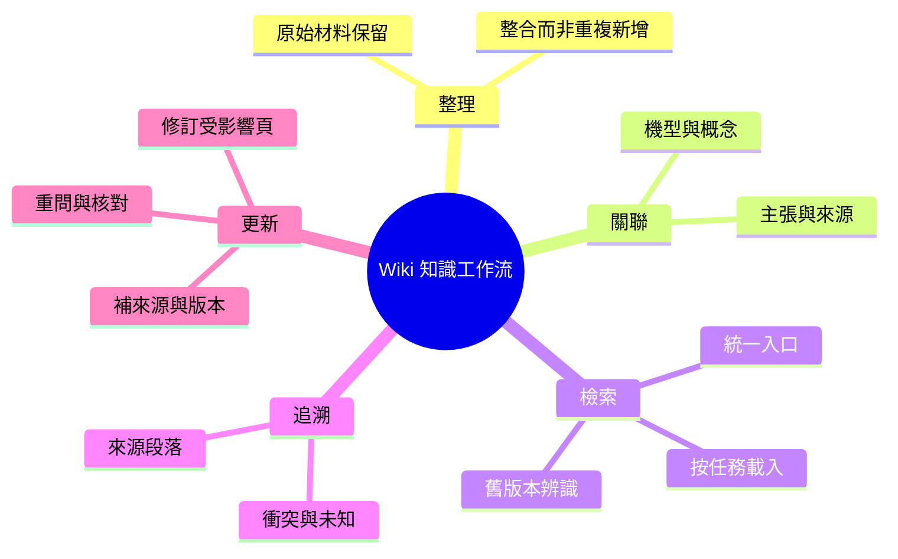

# Wiki Knowledge Workflow｜Agent 的知識整理與取用

**領域知識已經更正，下一次 Agent 為什麼仍可能回答舊內容？**

本專案研究以 Markdown Wiki 支援 Agent 的知識工作：將原始材料整理成相互關聯的知識頁，依任務檢索，回答時追溯來源，並在新知識進來時更新既有內容。Wiki 是持續整理的知識層；Agent 取用它生成回答時，形成 retrieval-augmented generation 工作流程，不以向量資料庫作為必要條件。

目前主案例來自既有工作站的一次產品知識校正：Agent 把某個必要結構描述成可選擴充；使用者提供領域知識，Wiki 隨後更新多頁。現存檔案顯示，舊機型卡與新版 Wiki 仍並存，部分查詢指引指向舊卡，部分已更正頁面未同步補上修正來源。

**狀態：已完成一組本機檢索、生成、隔離更新與重問實驗；完整維護驗收未通過。** Repo 內可執行的 Change Impact 工具是維護模組；它的測試不能替整套 Wiki 工作流背書。

## 從哪裡開始看

| 想了解 | 入口 |
|---|---|
| 真實模型執行與失敗分析 | [2026-10-11 實驗報告](docs/wiki-workflow/experiment-2026-10-11.md) |
| 可檢查的去識別來源節錄 | [案例節錄與輸出對照](docs/wiki-workflow/case-excerpts.md) |
| 實際問題、證據及使用者的判斷 | [知識校正案例](docs/wiki-workflow/case-study.md) |
| 五項功能如何共同工作、目前缺哪段 | [系統架構與責任](docs/wiki-workflow/architecture.md) |
| 怎麼檢驗「整理成 Wiki」是否有用 | [實驗規格](docs/wiki-workflow/experiment.md) |
| 目前已能執行的維護工具 | [Change Impact 使用與驗證](docs/change-impact-tool.md) |

## 完整工作流

圖中 Ingest、Query、Review、Write-back 包含 Agent 與人類操作；不表示目前已有一個自動執行全部步驟的服務。現有 SOP 和歷史紀錄、這次可驗證的檔案狀態、尚待實作的實驗在文件中分開列明。

## 案例揭露的技術問題

1. **入口衝突**：新入口指向 Wiki，另一份查詢規則仍把舊卡當優先來源。修正知識頁不等於修正取用路徑。
2. **來源鏈漏更新**：某些頁面正文已納入修正，metadata 卻仍保留舊日期和來源集合。來源存在性檢查抓不到這種缺漏。
3. **未知不能被補成事實**：修正紀錄保留了沒有數值依據的問題；回答完整度不能以自行補出數字取得。

這些是目前檔案與保存紀錄支持的發現。它們尚未證明每次 Agent 都會走錯路，也未證明新架構能降低多少錯誤。

## 技術棧與貢獻

| 技術／方法 | 中文用途 | 現況 |
|---|---|---|
| Markdown + YAML | 知識頁、類型、來源與關係 | 既有 Wiki 使用 |
| Index-first / file search | 索引導覽、關鍵字與按需讀取 | 已做固定案例；模型未遵守 index-first |
| Agent instructions | Ingest、Query、Lint 與未知處理 | 既有規則；遵守程度需看實際工具紀錄 |
| Qwen + MLX / bounded tool loop | 本機生成、受限檢索與隔離修訂 | 已完成五組查詢；完整維護未通過 |
| Python + PyYAML | 來源解析、快照、變更影響報告 | Repo 內可重跑模組 |
| SHA-256 + reverse graph / BFS | 版本辨識、下游依賴提示 | 不判讀語意或補齊漏宣告來源 |
| Human / AI review | 領域校正、引用與輸出審查 | 人類知識校正與 AI review 分別記錄 |
| Git + JSON + HTML | 版本、實驗紀錄、可讀報告 | 已保存真實執行與失敗；私人完整紀錄僅本機 |

使用者在保存材料中提供領域校正、要求按需檢索並挑戰分散入口；歷史 Agent 協助整理知識頁與規則。本輪 Codex 負責來源核對、案例還原與模組實作。不是權重訓練，也不把通用圖遍歷算法宣稱為自研研究方法。

## 驗收順序

- [x] 從實際材料找出一條「問題→校正→知識更新」鏈，標明證據限制。
- [x] 核對現存入口衝突及來源漏補，交獨立 reviewer 只讀核對材料；不代表系統驗收。
- [x] 將既有變更檢查器定位為維護模組，保留其實作與可重跑測試。
- [x] 在隔離複本保存真實檢索紀錄，比較原始文件與 Wiki 取用。
- [x] 固定模型與問題，保存完整生成輸出並分開評核主張、引用、拒答。
- [x] 執行新來源整合、既有頁更新、重問與 reviewer 核對，保存失敗。
- [ ] 通過完整維護驗收：來源、日期、入口與log同步；衝突查核及術語正確。

私人對話與業務完整原文不在此 repo；[案例頁](docs/wiki-workflow/case-study.md)明示哪些只能由持有本機來源的人核對。研究主張以材料可支持的範圍為限。

Author: Nio (Master) · Reconstruction and implementation: Codex · 2026-10-10
