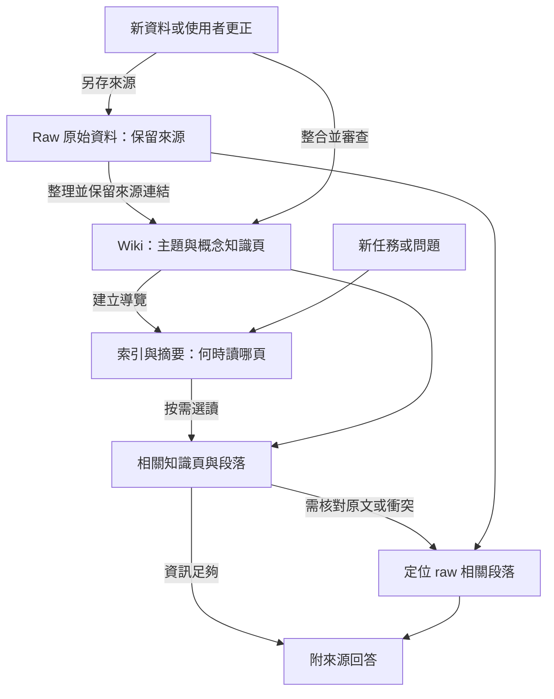
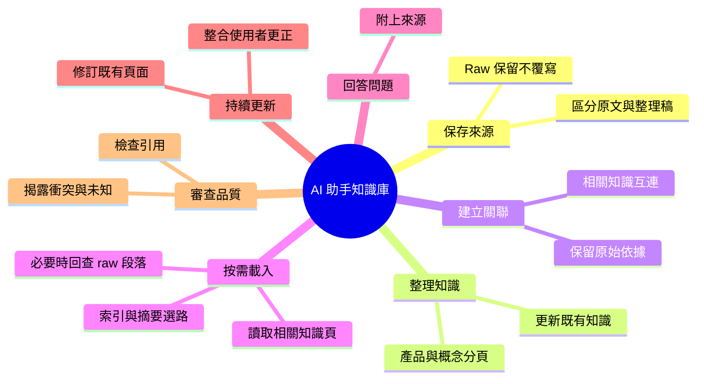

# AI 助手知識庫

**保留原始資料（raw），整理成有索引與來源的 Wiki，讓 AI 依任務按需載入知識。**

適用情境：產品資料、技術說明與工作經驗散落在文件和對話裡。先將材料整理為相互連結的知識頁；設計的取用路徑是讓 AI 先看索引判斷要讀哪裡，再載入相關內容，需要核對時回查原始資料。

目前是**可用腳本執行的研究原型**：已實際跑過查資料、回答、更新與再次提問；知識更新仍有缺漏，需要人工審查。

## 一個例子：教過 AI 的產品知識，下次找得到嗎？

假設你用 AI 準備產品說明，發現它把必要零件寫成選配。你告訴它：

> 「這個輔助導軌是必備結構，不是選配，也不是升級項目。」

你希望這次更正能留下來，之後再問同一個產品時，AI 能找到正確內容與依據。以下是本專案真實實驗的去識別摘要：

| 操作 | 本次實際結果 |
|---|---|
| **更新前提問**：「這個導軌是必備還是選配？」 | 在人工重建的更新前資料中，AI 找到「可擴充」描述，回答目前無法確定。 |
| **提供新知識**：加入使用者的校正紀錄 | AI 提出修訂，更新三張知識頁與索引；修改只套用於實驗複本。 |
| **換新上下文再問**：同一個問題 | AI 查到校正紀錄與概念頁，回答「必備」，並附上來源。 |
| **檢查是否真的更新完整** | 正文改了，但三頁漏補來源和日期，操作紀錄也沒更新。因此更新尚未通過審查。 |

這個例子展示了目前能運作的流程，也留下明確的待改善部分。回答節錄、來源對照與判定方式見 [案例對照](docs/wiki-workflow/case-excerpts.md) 與 [實驗結果](docs/wiki-workflow/experiment-2026-10-11.md)。

## 它怎麼工作？

| 組成 | 用途 |
|---|---|
| **Raw／原始資料** | 留存文件與對話來源，不因摘要或修訂 Wiki 而覆寫。口述整理稿需標明性質，不能當逐字原文。 |
| **Wiki／知識頁** | 將材料整合為產品、概念與主題，保留來源連結；新知識更新相關頁面。 |
| **Index／索引與摘要** | 告訴 AI「什麼任務需要讀哪一頁」，作為按需載入的入口。 |

**按需載入（On-demand loading）**：先看索引與摘要 → 選讀相關知識頁 → 需要細節或遇到矛盾時，定位 raw 的相關段落。讓原始資料可追溯，同時控制每次進入模型上下文的內容。

上圖是本專案的知識組織與取用設計。**目前執行器已支援按需搜尋與分段讀取，但沒有強制模型依序經過索引、摘要、全文三層。**它預載入口資訊與檔名清單，之後由模型決定搜尋、讀哪個檔案及起始行；實驗保留實際讀取紀錄，供檢查是否走對路徑。

這裡的 **RAG（檢索增強生成）** 是先取得外部知識再回答；Wiki 負責在查詢之前整理材料、建立關聯，並在之後持續整合新知識。

## 現在可以做到哪裡？

- **查資料並回答**：本機模型可搜尋、讀取指定文件，產生附來源的回答；每次讀取與輸出都有紀錄。
- **接收更正並修訂**：模型可提出知識頁修改，由程式檢查後套用到隔離複本。
- **檢查更新缺漏**：工具可提示受變更影響的頁面，並檢查本案更新是否漏掉來源、日期與操作紀錄。

**還沒做好的是可靠性。**實測仍出現術語錯譯、沒查舊版本卻說「沒有衝突」、以及正文更新但來源未同步。這是單一案例的原型驗證，尚不適合無人審查地維護正式知識庫。

## 專案中的工作與分工

Nio 提出按需取用知識的需求，提供產品領域校正，並指出分散入口與回答品質問題；AI 協助整理知識、撰寫程式與執行實驗。專案保留實際來源、模型輸出及獨立審查，區分已完成的功能與尚未解決的問題。

## 技術與程式

| 技術 | 在這個專案做什麼 |
|---|---|
| Markdown + YAML | 保存知識內容、來源與頁面關係 |
| Python + PyYAML | 控制文件讀取、驗證修改、檢查更新缺漏 |
| Qwen + MLX | 在 Mac 本機執行模型問答與修訂提案 |
| File search／文件搜尋 | 依任務搜尋與分段讀取，按需送入模型上下文 |
| Git + SHA-256 | 記錄版本，核對實驗前後資料是否改動 |
| JSON + HTML | 保存執行紀錄，呈現結果供審閱 |

想看實作，可從 [問答與更新執行器](experiments/wiki-workflow/README.md) 開始；原有的 [變更影響檢查器](docs/change-impact-tool.md) 是其中的維護工具。

展開：功能心智圖與技術文件

- [系統架構](docs/wiki-workflow/architecture.md)
- [原始問題與案例背景](docs/wiki-workflow/case-study.md)
- [實驗設計](docs/wiki-workflow/experiment.md)
- [實測結果與失敗分析](docs/wiki-workflow/experiment-2026-10-11.md)

完整私人資料與模型回答留在本機；repo 提供程式、去識別節錄及結果摘要。完整私人案例無法僅靠此 repo 重跑。

Author: Nio (Master) · AI-assisted implementation and editing: Codex · 2026-10-12
