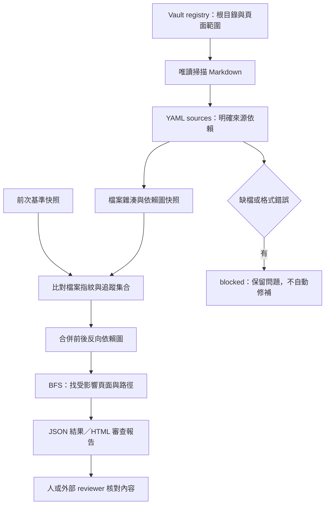
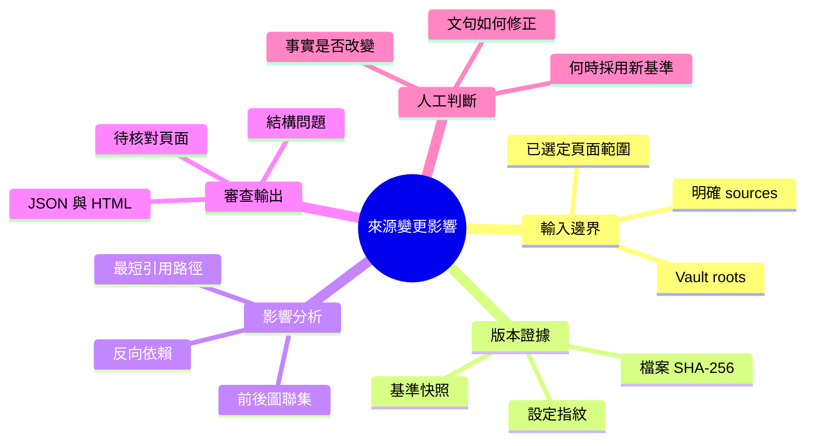

# Wiki Change Impact｜Wiki 來源變更影響分析

**一份來源更新後，哪些知識頁需要重新核對？**

本工具讀取 Markdown 的 `sources`，建立來源依賴圖並保存 SHA-256 快照。比對兩個版本時，列出變動檔案、直接與間接受影響的頁面，以及每頁的引用路徑。JSON 可接後續流程，HTML 供人檢閱。

這是 Wiki 更新流程中的唯讀檢查工具。它不修改 Wiki、不呼叫 LLM，也不以檔案變動推斷內容正確與否。

## 問題背景

Wiki 把原始材料整理成概念、產品與比較頁，讓 agent 不必每次重讀全部材料。但來源修正後，資訊可能散落在多頁；只檢查「連結還在」無法發現它們依賴的版本已改變。

既有工作站已具備 `raw → 整理文件 → wiki` 分層、`sources` 與日誌規則，以及欄位／連結 linter。本專案將其中的來源關係抽成可執行的**更新影響檢查**，並補上版本快照、反向依賴遍歷與審查報告。它與檢索工具互補：檢索回答「去哪裡找」，此工具回答「哪些地方需要重查」。

## 一個完整案例

範例全部使用合成資料，數值不代表真實產品。

1. 規格 v1 記錄 `1200 rpm`，概念頁引用它，產品頁再引用概念頁，比較頁引用產品頁。
2. 新增規格 v2，修正為 `1000 rpm`；舊來源保留。將概念頁的 `sources` 切到 v2，但頁面正文暫時仍是舊值。
3. 工具列出三頁待核對及各自的來源路徑。另一頁只透過 `related` 連結產品頁，不列入影響。
4. 範例腳本把三頁正文改成新值，再比對同一基準；結果仍為 `needs_review`。文字改過不代表已由人驗收。

```text
demo:raw/spec-v2.txt
  → demo:wiki/concept.md
  → demo:wiki/product.md
  → demo:wiki/comparison.md
```

報告中的一筆結果（節錄）：

```json
{
  "page": "demo:wiki/comparison.md",
  "reasons": [{
    "changed_source": "demo:raw/spec-v2.txt",
    "path": [
      "demo:raw/spec-v2.txt",
      "demo:wiki/concept.md",
      "demo:wiki/product.md",
      "demo:wiki/comparison.md"
    ]
  }]
}
```

每個變動來源對每頁保留一條最短依賴路徑。這筆輸出說明「為何要檢查比較頁」，不代表它已判讀頁面中的數字。

## 快速重跑

需要 Python 3.10+；只有 YAML 解析使用第三方依賴。

```sh
python3 -m venv .venv
.venv/bin/pip install -r requirements.txt
.venv/bin/python -B demo.py --out runs/demo
```

打開 `runs/demo/report.html`，即可檢視來源切換後的影響報告；`report.json` 與 `after-correction.json` 保存機器可讀結果。範例只操作複製到 `runs/demo/case/` 的合成資料，不接觸任何正式 Wiki。重跑需指定新的輸出目錄，避免覆寫先前證據。

```sh
.venv/bin/python -B -m unittest discover -s tests -v
```

## 資料契約與使用方式

Vault 是一個資料根目錄；登記多個 root 可以跨 Wiki 分析，檔案不用搬家。

```json
{
  "vaults": {
    "products": {"root": "/path/to/products", "pages": ["wiki/*.md"]},
    "research": {"root": "/path/to/research", "pages": ["notes/*.md"]}
  }
}
```

被 `pages` 選中的頁面必須有 YAML frontmatter：

```yaml
---
sources:
  - raw/spec-v1.txt
  - research:notes/material.md
---
```

- 本 vault 引用相對 **vault 根目錄**，跨 vault 引用採 `vault-key:path`。
- 檔案身分是 `vault-key:relative-path`，不依標題或概念 ID 猜配對。
- `sources` 是唯一會傳播影響的欄位。`related`、`applies_to`、正文連結與同義詞不會自動轉成依賴。
- 被引用的檔案若也在 `pages` 範圍，繼續解析其 `sources`；否則作為葉節點，只取檔案雜湊。若要追溯到更早的材料，需要把中介頁納入範圍且提供明確 `sources`。
- `pages` 使用 Python `fnmatchcase` 對 root-relative 路徑比對；`*` 可跨 `/`，所以 `wiki/*.md` 包含下層頁面。隱藏目錄與 symlink 目錄不掃描；來源檔案中的 symlink 拒絕讀取。

先建立基準，再做唯讀比較。輸出目錄需先存在；輸出不可位於任何 vault 內，亦不可覆寫既有檔案。

```sh
mkdir -p runs
.venv/bin/python -B wiki_impact.py --config config.local.json \
  snapshot --out runs/baseline.json

.venv/bin/python -B wiki_impact.py --config config.local.json \
  check --baseline runs/baseline.json --html runs/change-report.html
```

| 結果 | Exit code | 意義 |
|---|---:|---|
| `unchanged` | 0 | 已追蹤檔案未改變，不代表知識正確 |
| `needs_review` | 1 | 有版本／追蹤集合變動，需要檢閱 |
| `blocked` 或輸入錯誤 | 2 | 缺檔、解析問題、基準不合規等；不能作乾淨報告 |

`newly_tracked` / `no_longer_tracked` 表示檔案進出本次快照集合，未必是磁碟新增／刪除。失去來源引用時，仍保留舊依賴圖追蹤影響。建立新快照也不等於批准知識內容；基準應由操作者在核對後選定。

## 架構與演算法



先將 `page → source` 反轉成 `source → dependents`，另比對每頁來源集合，將切換引用的頁面直接列入待核對，再從每個變動檔案進行 breadth-first search（廣度優先搜尋）。前後兩版的邊取聯集，避免來源引用被刪掉時漏列影響；因此可能保守地多列頁面，包含跨版本拼接的路徑。`seen` 集合讓循環依賴能終止。

對 C 個變動檔案、V 個節點、E 條邊，遍歷上界為 O(C × (V + E))，另加讀檔與雜湊成本。此版不提供大型知識庫的增量索引或效能保證。



## 技術棧｜Technology stack

| 技術 | 中文用途 | 位置 |
|---|---|---|
| Python 3.10+ | CLI、唯讀檔案掃描 | `wiki_impact.py` |
| PyYAML 6.0.3 / SafeLoader | 解析 YAML，拒絕重複鍵 | `metadata()` |
| SHA-256 / JSON | 檔案版本指紋、可保存快照 | `snapshot()` |
| Reverse dependency graph / BFS | 反向依賴圖、廣度優先影響分析 | `compare()` |
| HTML / CSS | 無外部資源的靜態審查報告 | `render()` |
| unittest / TemporaryDirectory | 可重跑正反案例、測試隔離 | `tests/` |
| Mermaid | 流程圖、心智圖 | 本 README |

## 驗證結果與限制

- 合成來源版本切換：三個依賴頁列入，一個只有一般關聯的頁面排除；腳本修正文句後仍待驗收。
- 現有產品 Wiki 唯讀掃描：23 頁、33 個追蹤檔案、48 條來源依賴，本次範圍內 0 個結構問題。
- 隔離複本中變更引用最多的來源：18 頁受影響、5 頁不受影響；正式 Wiki 前後快照一致。這是影響機制測試，並非真實業務更正或內容準確率測試。

原始業務文件、私人對話與完整掃描快照不進 GitHub；repo 提供合成案例及去識別數據。[完整方法與結果](docs/experiment.md)。

目前不處理語意矛盾偵測、模型回答品質、概念 ID 解析、自動修文與 reviewer 核准流程。雜湊只能辨識位元組變動，格式調整也會觸發；未宣告依賴的內容則可能漏掉。掃描不是跨檔案原子快照，請在沒有同步編輯時執行。

Author: Nio (Master) · Implementation: Codex · 2026-10-09
