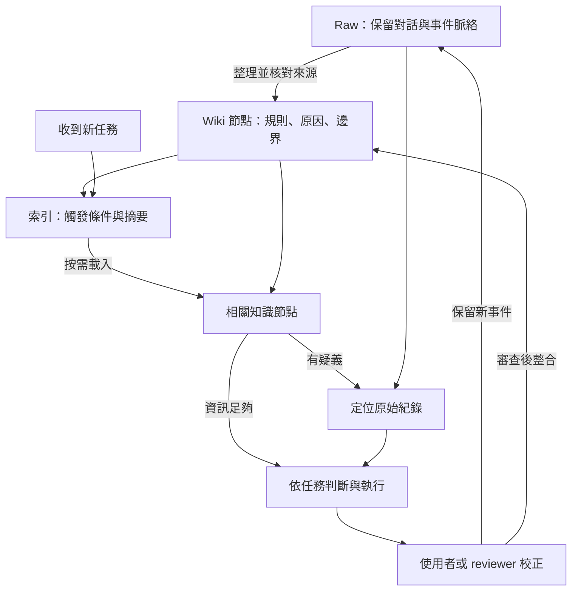

# AI_WORKSTATION Wiki：讓 Agent 按需取用協作知識

**把對話中累積的經驗整理成可追溯的知識，讓 agent 在接到任務時，找到相關規則、理解原因與適用邊界。**

長期使用 AI 助手，重要經驗往往散落在不同對話。這個作品以 AI_WORKSTATION 的協作 Wiki 為案例，說明如何保留 raw、整理知識節點、建立索引，並依任務按需載入。

Wiki 的直接使用者是 agent；人負責提出需求、校正理解與審查。這份 GitHub 說明則讓讀者理解設計及現有證據。

## 一個案例：AI 記住了結論，卻忘了原因

協作規則的現存紀錄指出：原本的要求是「使用第三方工具前先審查」，agent 卻將它記成「不裝第三方工具」。條件消失後，後續判斷就可能變成一律拒絕。

因此，整理進 Wiki 的規則需要包含三部分：

| 內容 | 概念化示例 |
|---|---|
| **規則** | 使用第三方工具前，先確認來源與風險 |
| **原因** | 避免在不了解工具的情況下引入風險 |
| **邊界** | 需要審查不等於一律禁止；完成審查後，依任務與授權判斷 |

下次遇到工具選用任務，設計的路徑是：**索引辨識任務 → 載入相關規則 → 理解原因與邊界 → 必要時回查原始紀錄 → 做出有依據的判斷。**

這是根據現存 Wiki 節點整理的設計案例；上表是概念轉述，不是逐字對話，也沒有宣稱已用新 session 驗證行為改善。[案例與證據範圍](docs/wiki-workflow/case-study.md)

## Raw、Wiki、按需載入各做什麼？

| 組成 | 功能 |
|---|---|
| **Raw／原始紀錄** | 保留協作發生的脈絡，整理知識時不覆寫來源；原話、整理稿與推論應區分 |
| **Wiki／知識節點** | 將經驗整理為規則、原因與邊界，建立相關、細化、取代等關係 |
| **Index／索引** | 用「何時需要讀＋內容摘要」引導 agent 找到適用節點 |
| **On-demand loading／按需載入** | 先看入口與摘要，再讀相關內容；有疑義才定位原始紀錄，不把所有歷史塞入每次對話 |

這是知識維護與取用的設計流程。索引和規則存在，不代表 agent 每次都載入或遵守；需看實際讀取紀錄與行為才能確認。

## 架構的重點

- **來源可回查**：摘要不取代原始脈絡，來源不足時保留未知。
- **載入有條件**：索引提供任務觸發條件，完整節點提供細節。
- **規則有理由**：保留 why 與邊界，避免把條件句變成絕對禁令。
- **知識持續整合**：校正既有節點，標明取代或矛盾關係，避免同一規則多份並存卻無法判斷。

```mermaid
mindmap
  root((Agent 協作 Wiki))
    Raw 來源
      對話與事件
      保留原始脈絡
    Wiki 知識
      規則與原因
      適用邊界
      節點關係
    按需載入
      任務觸發
      索引與摘要
      相關內容與來源
    更新與審查
      人的校正
      整合既有節點
      查驗讀取與行為
```

## 目前有哪些證據？

**已核對的既有設計**：AI_WORKSTATION 的協作記憶索引、節點格式、保留根因的規則，以及 agent 作為 Wiki 使用者的定位。它們支持上述案例與架構說明；私人原文保留本機，repo 提供概念轉述與來源說明。

**repo 內的輔助程式**：來源變更影響檢查器、受限搜尋與分段讀取執行器、隔離更新與欄位檢查。它們是研究工具，尚未串成這個協作 Wiki 案例的完整自動服務。過去其他案例的模型結果不作為本案例驗證。

**尚未證明**：每次任務都正確觸發載入、跨 session 穩定遵守規則，以及按需載入帶來多少品質或成本改善。

Nio 提出跨 session 協作需求，指出記憶與呈現中的誤解，並要求保留原因、邊界和來源；agent 協作整理知識與實作研究工具。

## 技術棧與深入閱讀

| English | 中文 | 用途 |
|---|---|---|
| Markdown + YAML | 知識文件與欄位 | 保存規則、摘要、來源線索與關係 |
| Typed links | 具語意的關係 | 區分相關、取代、矛盾與細化 |
| File search + partial read | 文件搜尋與分段讀取 | 按任務選擇送入模型上下文的內容 |
| Python + PyYAML | 輔助檢查程式 | 分析依賴、驗證隔離修改與欄位 |
| Git + SHA-256 | 版本與檔案指紋 | 追蹤變更；不代表內容正確 |
| Qwen / MLX | 本機模型實驗環境 | 執行器可用的推論環境，非本案例新增測試結果 |

[案例背景](docs/wiki-workflow/case-study.md) · [來源與概念對照](docs/wiki-workflow/case-excerpts.md) · [系統架構](docs/wiki-workflow/architecture.md) · [驗證問題](docs/wiki-workflow/experiment.md) · [變更影響工具](docs/change-impact-tool.md) · [檢索與更新執行器](experiments/wiki-workflow/README.md)

Author: Nio (Master) · Evidence review and editing: Codex · 2026-10-14
