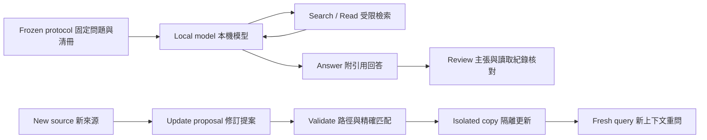

# Wiki 工作流實驗執行器

Author: Nio (Master) · Implementation: Codex · 2026-10-11

此目錄提供本機模型的受限檢索迴圈與隔離更新控制器。不是完整 Agent 框架，也不是向量檢索服務。

| 組件 | 技術與中文用途 |
|---|---|
| `run.py` | Python 標準庫 + 本機 Chat Completions 相容介面；模型選擇 search/read，控制器只讀 frozen manifest 內文件 |
| `audit_update.py` | PyYAML；阻擋已改知識頁漏來源／日期、未更新log、raw異動；不驗語意 |
| `update.py` | Exact replacement 精確替換；先驗證路徑、唯一匹配與重疊，再建立隔離更新複本 |
| JSON / SHA-256 | 保存提示、完整 API 回應、工具 trace、檔案版本與終止狀態 |
| Qwen / MLX | 本機推論環境；非目前協作 Wiki 案例的新測試結果 |
| Independent AI review | 逐主張核對真實來源與工具結果，不以格式通過代替語意正確 |



## 執行

先依 repo requirements 安裝既有 PyYAML 依賴，再啟動自己的本機模型。執行器固定只連 `127.0.0.1:18080`，不會啟停或安裝模型。

```sh
python3 experiments/wiki-workflow/run.py CORPUS PROTOCOL_JSON NEW_OUTPUT_DIR
python3 experiments/wiki-workflow/update.py BEFORE_CORPUS NEW_SOURCE UPDATE_PROTOCOL_JSON NEW_OUTPUT_DIR
python3 experiments/wiki-workflow/audit_update.py BEFORE_CORPUS AFTER_CORPUS UPDATE_PROTOCOL_JSON NEW_AUDIT_JSON
python3 -m unittest discover -s experiments/wiki-workflow -p 'test_*.py'
```

每次輸出目錄必須不存在，避免覆寫歷史。私人 corpus 和完整輸出應放 repo 以外。協定提供 model、question、entry、manifest、temperature=0、固定 limits；manifest 為相對路徑→SHA-256。更新協定提供 before_manifest、new_source、source_sha256、allowed_paths、model、date。具體格式與控制流程可直接查兩個腳本。

限制：每組最多2次 literal search、6次 read，每次最多80行；檢索正文最多18,000字元，不含入口預載與JSON包裝。格式修復最多2次且計入10輪上限。完整API usage原樣保留，未將cached tokens當成新的輸入成本。

這是局部案例的開發執行器。正文截斷、檔案缺失、格式失敗與未知回答均應保留。`read_calls` 包含可能為空的合法範圍讀取，因此 reviewer 必須核對 trace 中實際回傳正文，不單用計數認定有讀到。模型沒有通用 shell 或網路工具，但這不是作業系統級安全沙箱。

精確補丁可套用只代表機械檢查通過；更新狀態固定標 `applied_needs_semantic_review`，不能自動升為可信知識。程式測試只驗證控制器邊界，不代表模型回答品質。
